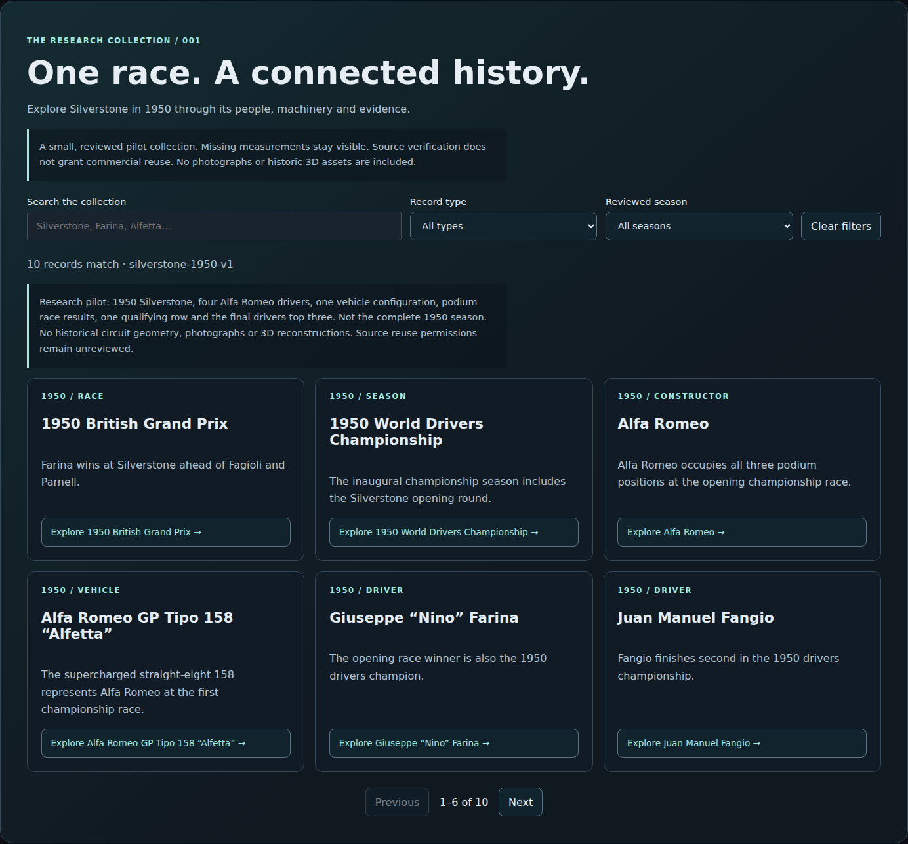
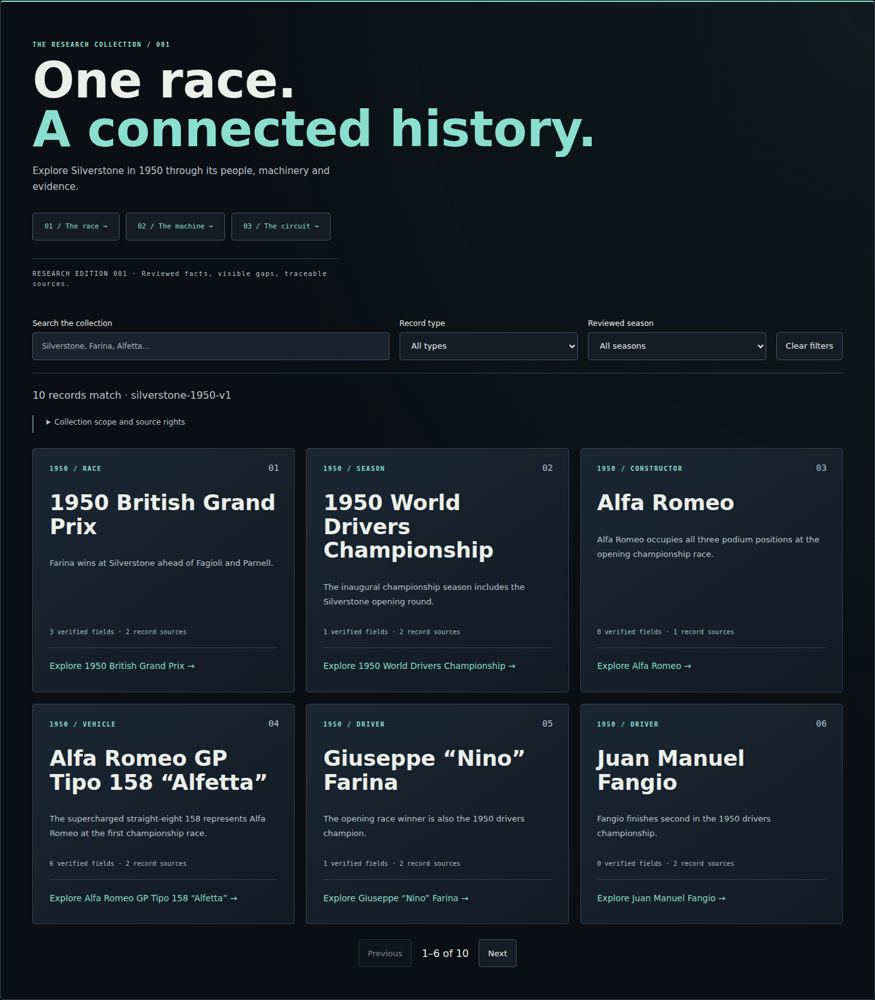
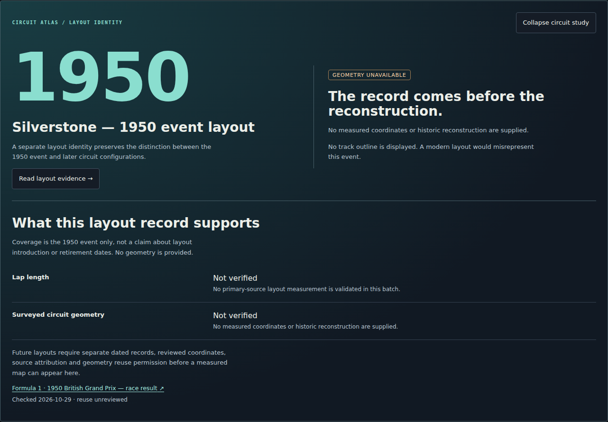

# Heritage Museum Stage 2 — editorial integration

## Scope and reference audit

2026-10-29. Builds on remote `9013088` on `work/heritage-platform`. Local Git is the source snapshot from that remote commit, not a clone retaining identical commit hashes. PR #1 still targets `feat/f1-web-publication`.

Actual code references: `professional.css` (site tokens, cinematic headings, buttons), `CinematicHome.tsx`, `vehicles.css` / vehicle library, `heritage.css` / existing exhibits, `main.tsx` / navigation and Race Centre, and `RaceScenes.tsx` / dashboard styles (read only). No shared CSS, routing, dependencies, models or simulator files change.

| Pattern | Existing site | Museum application |
|---|---|---|
| Surfaces | `--ri-bg` #0b0e12, `--ri-surface` #151c26 | Same inherited navy surfaces; subtle teal light at the header |
| Type | Barlow Condensed display, DM Sans body, IBM Plex Mono labels | Same tokens on collection title, record titles, index and field counts |
| Colour | Orange main CTAs; teal engineering force readouts | Existing site orange navigation remains; research uses #8adecf teal |
| Borders | Fine #354151 dividers, 4–8px radii | 4–5px cards and controls replace isolated rounded database treatment |
| Hierarchy | Large editorial statement, explanatory body, small technical labels | Two-line opening, three guided entry points, then search and records |
| Interaction | Border emphasis, small hover movement, reduced-motion guard | Scoped card lift and border emphasis; no animation under reduced motion |

Current-run browser reference captures live in `docs/previews/stage2/reference-*.png`. The homepage demonstrates headline scale and surface continuity. Engineering demonstrates warm exhibit accents with teal calculations. Vehicle library code provides technical labels and border treatments, but its browser route opens the existing error boundary in this environment; that screenshot is a blocker record, not accepted design evidence. Race Centre capture records only the available source-checkout state; missing binaries prevent a complete simulator rendering review. None of the simulator is changed to address that limitation.

The cloud browser cannot reach this environment's loopback server (connection refused). The repository's local Chromium browser test runner performs the actual captures and interactions against a real local API. External Google Fonts do not load in this environment and original binary images/models are absent from this checkout; screenshots display browser font fallbacks and asset fallback states. This is not evidence that original 3D assets or branded typography render in production.

## Captured steps and findings

1. **Before collection — functional, visually detached.** `before-desktop.png` and `before-mobile.png` show rounded cards, uniform body-style headings and two prominent coverage blocks ahead of the records. Filtering works; the reading order is dominated by database explanations.
2. **Refined collection — passes responsive checks.** `after-desktop.png`, `after-tablet.png`, `after-mobile.png` show the editorial title, guided race/machine/circuit entry points, numbered record cards, source counts and collapsible coverage disclosure. Scope and rights remain available without dominating the opening. Columns are 3 / 2 / 1 at 1440 / 834 / 390px; document and gallery widths are checked for overflow.
3. **Connected record and exhibit — navigation passes.** The machine record opens the existing Alfa 158 exhibit; timeline, experiments and historical race links reuse existing museum URLs. Existing related-record links preserve driver/constructor/circuit relationships and source evidence. Editorial exhibits and reviewed records remain distinct.
4. **Historical circuit study — evidence experience passes.** `circuit-*.png` show dated layout identity and expandable source/measurement evidence. No measured map, illustrative outline or modern geometry is supplied. This is an expandable circuit evidence viewer, not a geometric reconstruction.
5. **Keyboard, failure and motion states — targeted checks pass.** Existing search, retry, cancellation, focus and pagination checks remain. Expansion exposes `aria-expanded` / `aria-controls`; hidden evidence leaves the accessibility tree. Native disclosure keeps scope accessible. Reduced-motion tests verify hover transitions become zero duration. Screenshots alone cannot establish full WCAG compliance.

## Circuit extension contract

`HistoricalCircuit.tsx` consumes the existing API `Entity` and `Source` contracts. Circuit records discover linked layout records through API relationships; layout records open their own study. Additional reviewed layouts can be reached using the same graph without importing simulator assets. Dates describe reviewed event coverage rather than guessed layout service dates.

The current pilot explicitly lacks measured lap length and coordinates. Before adding a measured map, introduce a separately validated geometry asset with dated configuration identity, coordinate system, measurement accuracy, provenance and reuse permission. A future illustrative representation needs a persistent illustrative/not-to-scale label and a separate data type; it must not be silently promoted to verified geometry. No placeholder map is drawn in this stage.

## Changed files

- `frontend/src/heritage/HeritageCatalogue.tsx`: guided entry points, museum links, scoped coverage disclosure, card evidence metadata, circuit study integration.
- `frontend/src/heritage/HistoricalCircuit.tsx`: independent expandable layout evidence experience.
- `frontend/src/heritage/catalogue.css`: scoped design-token reuse, typography, surfaces, responsive grids and motion rules.
- `tools/check_heritage_browser.mjs`: desktop/tablet/mobile captures, expansion/collapse, no-geometry checks, exhibit navigation, motion and reference captures.
- Documentation: this design review, work progress, integration notes and executed test results.

## Review limits

No data expansion, schema change, source-rights change, AI call or upstream ingestion. SQLite, ingestion, API validation and historian remain untouched. No merge or deployment. Complete original assets, working external fonts and reviewed geometry remain separate review requirements. No new dependencies are introduced.

## Review screenshots

Component captures use the same desktop width before and after. These are browser screenshots, not generated design mockups.

| Before | After |
|---|---|
|  |  |

[Tablet](previews/stage2/after-tablet.png) · [Mobile](previews/stage2/after-mobile.png) · [Before mobile](previews/stage2/before-mobile.png) · [Full museum context](previews/stage2/museum-context.png)

[Circuit tablet](previews/stage2/circuit-tablet.png) · [Circuit mobile](previews/stage2/circuit-mobile.png)

Reference evidence: [Homepage](previews/stage2/reference-home.png) · [Existing engineering exhibit](previews/stage2/reference-engineering.png) · [Library blocker](previews/stage2/reference-library.png) · [Available Race Centre state](previews/stage2/reference-race-centre.png)
