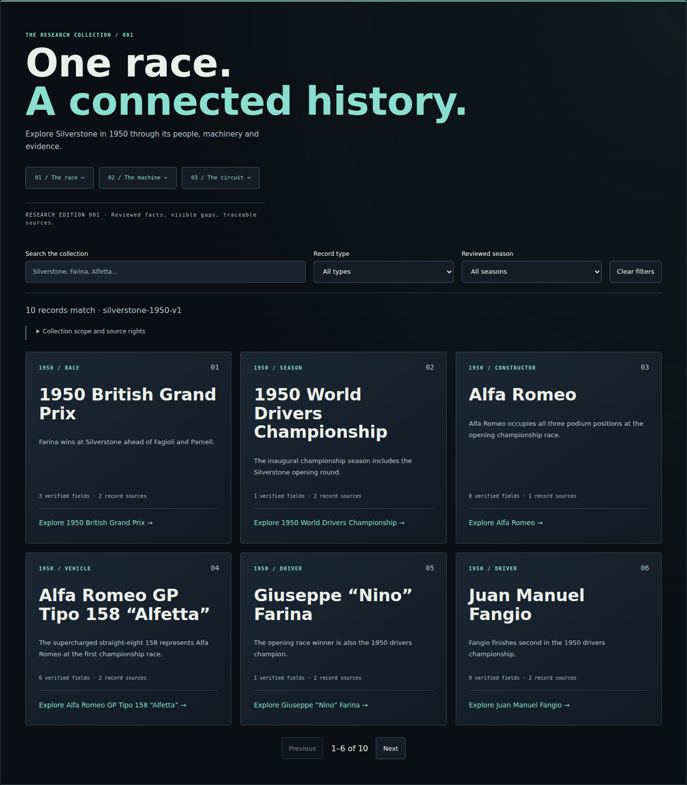
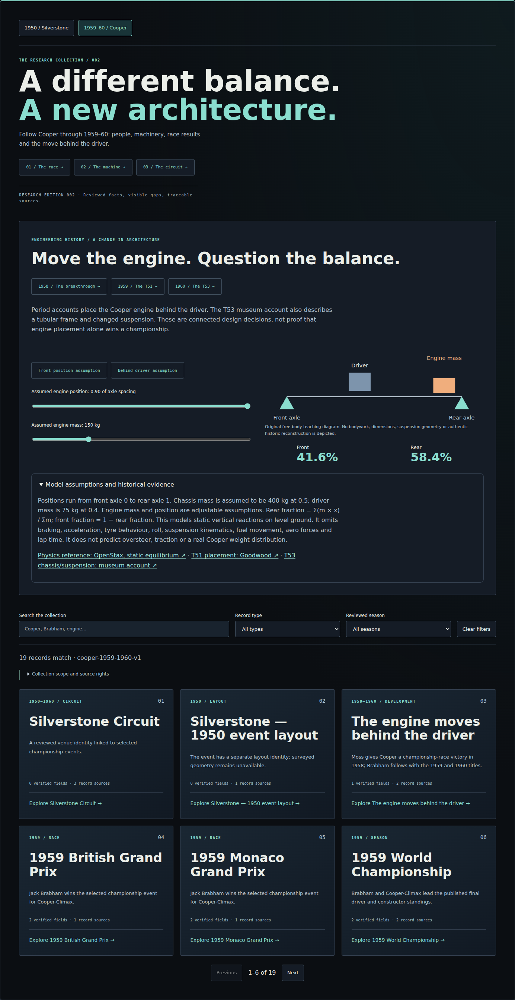
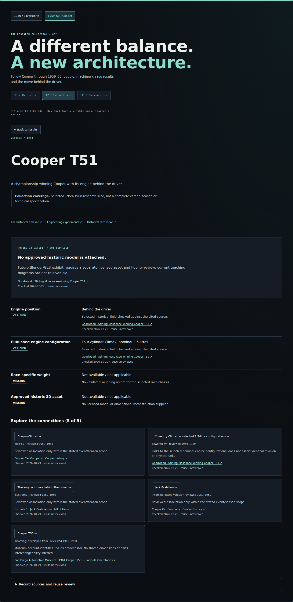
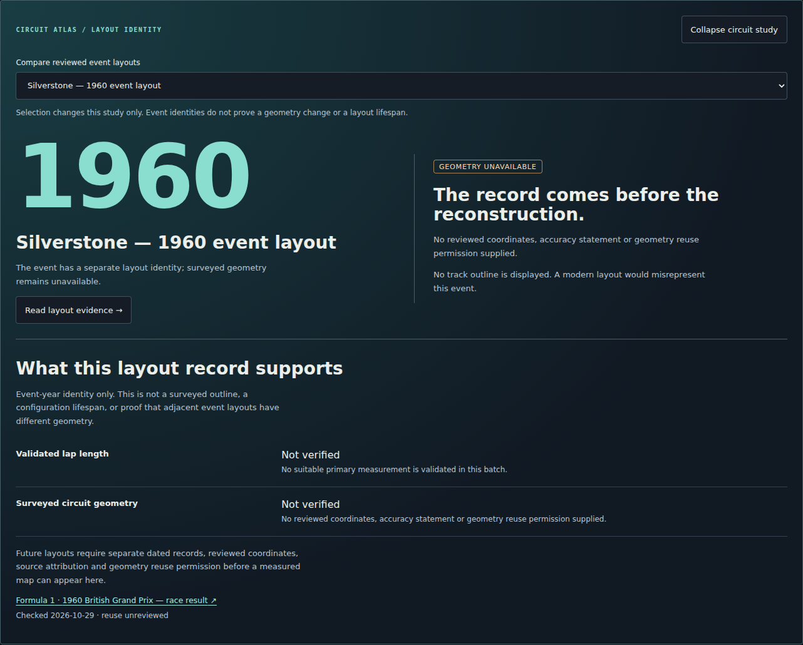

# Stage 3 — browser visual review

The accepted Stage 2 design remains the reference: navy surfaces, restrained teal engineering accents, editorial display/body/mono tokens, fine borders, four-pixel controls and the existing research cards. `catalogue.css`, global styles and navigation are unchanged. The added chapter control, teaching panel and exhibit-readiness panel reuse those patterns through museum-scoped `stage3.css`.

Screenshots below are actual Chromium captures against the local FastAPI/Vite app, not generated artwork or proposed mockups. Original fonts/assets are unavailable in this source-only environment; font fallback fidelity is not a production typography sign-off. No historic car photograph or mesh is substituted.

## Captured steps

1. **Original chapter — passes.** The existing 1950 catalogue remains default. A small museum-local chapter selector is the intentional addition above its header; the original heading/card treatment stays intact.
2. **Cooper chapter and teaching experience — passes.** Guided race/machine/circuit entry points lead into the new slice. The original free-body diagram and live percentages respond to presets and keyboard ranges. Expanded assumptions are captured so the numbers cannot be mistaken for measured history.
3. **Connected T51 record — passes.** Historical claims, source links, missing measurements and connected records stay readable. A dedicated panel says that no approved historic model is supplied.
4. **Silverstone layout family — passes.** Selecting 1950 or 1960 updates the circuit study and citations while explicitly distinguishing event identity from measured geometry. No modern outline or invented historic map appears.
5. **Responsive/keyboard/error review — targeted checks pass.** Desktop 1440, tablet 834, mobile 390 and narrow 320px are checked for gallery/document overflow. Mobile uses a single column and wrapping controls. The review catches narrow-screen heading/value wrapping; a Cooper-only heading rule and nonwrapping smaller percentage values fix those without changing the original chapter. Native labels/selects/buttons/ranges/details and live result text support keyboard and nonvisual use. Reduced-motion mode is active during captures; the new diagram has no animation loop.

Full WCAG compliance, screen-reader testing, 200% zoom, actual fonts and original-asset Mac/Safari rendering remain manual gates. These screenshots do not claim otherwise.

## Reference and implementation

| Accepted Stage 2 catalogue | Current original chapter |
|---|---|
|  |  |

The additional chapter row deliberately shifts content downward; this is not a pixel-identical screenshot claim. No generic template replaces the existing design.

[Tablet](../previews/stage3/cooper-tablet.png) · [Mobile](../previews/stage3/cooper-mobile.png) · [Narrow mobile](../previews/stage3/cooper-narrow.png)

[Mobile circuit evidence](../previews/stage3/silverstone-family-mobile.png)
